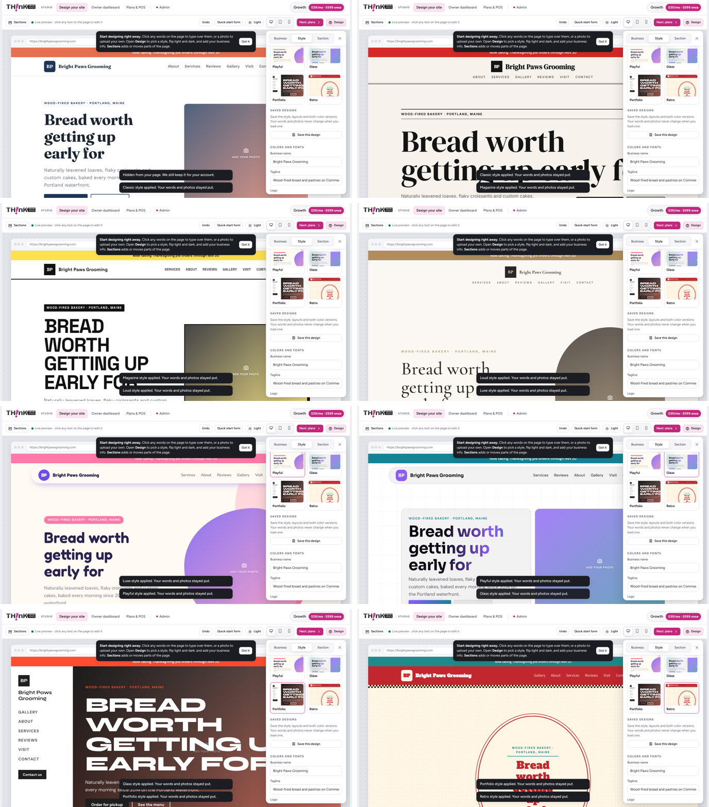
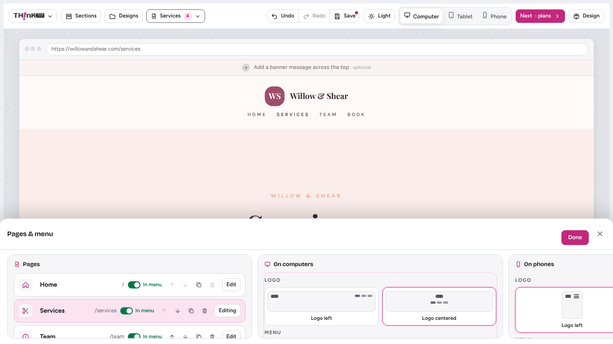
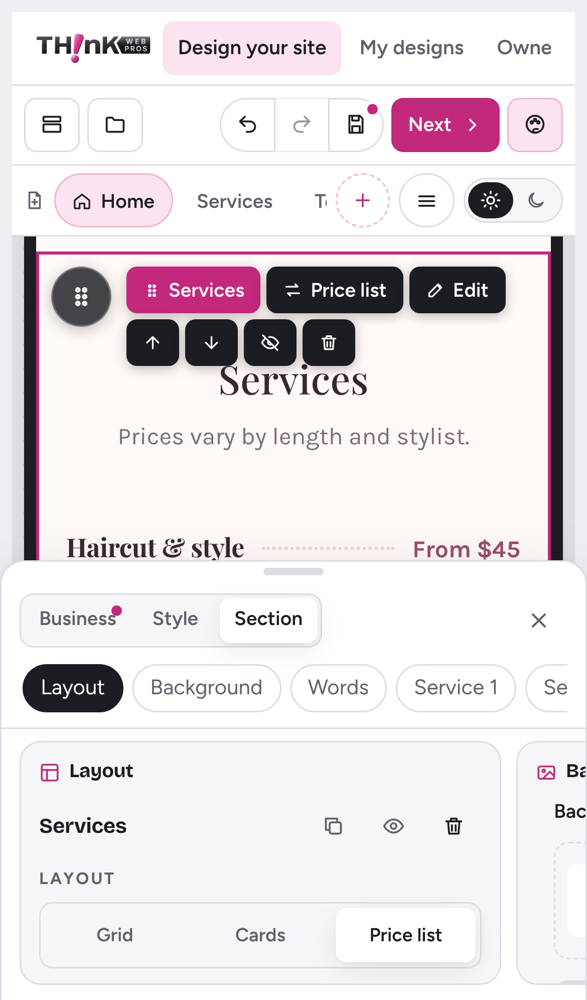

# Think Web Pros Studio

Think Web Pros builds websites for small businesses. In the Studio, an owner designs their site, uploads or creates a logo, tweaks the style as much as they like, and then buys the site along with web services (hosting, domain, POS and more).



## What's here

| Path | What it is |
| --- | --- |
| `web/` | Plain HTML, CSS and JavaScript, no build step. |
| `web/index.html` | The marketing landing page at `/` (meta tags, schema.org data, FAQ). `robots.txt`, `sitemap.xml` and `llms.txt` sit next to it. |
| `web/builder.html` | The Studio (designer) at `/builder`. |
| `web/js/help-content.js` | Help articles for the Studio's Help panel and first-time tour (`web/js/help.js`). |
| `web/js/app.js` | The designer, plans and checkout, owner dashboard, and admin views. |
| `web/js/platform.js` | Connects the Studio to the server (AI logo maker and order submission). |
| `web/js/payments.js` | Paying for an order (Stripe, PayPal/Venmo, Zelle), pay links, and the Payments panel in Admin > Orders. |
| `server/` | Node + Express server that serves the Studio and the API. |
| `test/` | Server tests (`npm test`). |

## Run it

Requires Node 20 or newer.

```bash
npm install
cp .env.example .env   # optional, then fill in values
npm run dev            # http://localhost:3000 (Studio at /builder)
```

Set environment variables in your shell or host (the server doesn't read `.env` on its own; use `node --env-file=.env server/index.js` if you want it to):

- `ANTHROPIC_API_KEY` turns on the live AI logo maker. Without it, the logo maker uses its built-in quick ideas.
- `ADMIN_TOKEN` unlocks `GET /api/orders` and the problem reports in Admin. Without it, orders can be placed but not read over the API.
- `DATA_DIR` is where orders are saved (default `data/`) when Redis isn't set up.
- `UPSTASH_REDIS_REST_URL` and `UPSTASH_REDIS_REST_TOKEN` (or Vercel's `KV_REST_API_URL` and `KV_REST_API_TOKEN`) keep orders, owner accounts, shops, stock and shop orders in Redis. Without Redis they are files under `DATA_DIR` (on Vercel that is `/tmp`, which is wiped, so connect Redis before real use).
- Payments: `STRIPE_SECRET_KEY`, `STRIPE_WEBHOOK_SECRET`, `PAYPAL_CLIENT_ID`, `PAYPAL_CLIENT_SECRET`, `PAYPAL_ENV`, `ZELLE_RECIPIENT`, `ZELLE_NAME`. Each way to pay shows up once its keys are set. See [docs/payments-setup.md](docs/payments-setup.md).
- `TURNSTILE_SITE_KEY` and `TURNSTILE_SECRET_KEY` turn on the bot check, and `AI_PER_DAY` / `AI_DAILY_TOTAL` change the AI limits. See Security below.

Or with Docker:

```bash
docker build -t think-web-pros .
docker run -p 3000:3000 -e ANTHROPIC_API_KEY=... -e ADMIN_TOKEN=... -v twp-data:/app/data think-web-pros
```

## Host it on Vercel

`vercel.json` serves `web/` as static files and runs the API from `api/index.js` as a serverless function. In Vercel choose **Add New > Project**, import this repo, and deploy with the defaults. Add `ANTHROPIC_API_KEY` (optional) and `ADMIN_TOKEN` under **Settings > Environment Variables**, then redeploy. Every push to `main` redeploys.

Before taking real orders, add Upstash Redis under **Storage** so orders last; without it they go to the function's temporary disk and disappear. Vercel caps request bodies at 4.5 MB, so an order whose design has large photos is sent without the design (it is marked `designTooLarge`) and payment still goes ahead.

## API

| Method | Path | Notes |
| --- | --- | --- |
| GET | `/api/health` | Liveness check. |
| GET | `/api/config` | `{ ai, payments }`: whether the live AI logo maker is on and which ways to pay are set up. |
| POST | `/api/ai/sample` | `{ prompt, json? }` → `{ text, json? }`. Rate limited per IP. The API key stays on the server. |
| POST | `/api/orders` | `{ order, design }` from checkout. The server prices it from `server/catalog.js` and returns `{ id, number, payment }`. |
| GET | `/api/pay/:id` | What a customer sees on the pay screen (`/builder?pay=<id>`). |
| POST | `/api/pay/:id/card` | Starts Stripe Checkout, returns `{ url }`. |
| GET | `/api/pay/:id/card/result` | Checks a finished Stripe Checkout (`?session_id=`). |
| POST | `/api/pay/:id/paypal` | Starts a PayPal order (`{ paypalOrderId }`) or subscription plan (`{ planId }`). |
| POST | `/api/pay/:id/paypal/confirm` | Captures or checks the PayPal payment. |
| POST | `/api/pay/:id/zelle` | Returns Zelle instructions and marks the order as waiting for Zelle. |
| POST | `/api/stripe/webhook` | Stripe events: payments, renewals, failed renewals, cancellations. |
| GET | `/api/orders` | Admin list (`Authorization: Bearer <ADMIN_TOKEN>`). |
| GET | `/api/orders/:id` | One order with its full design. |
| POST | `/api/reports` | `{ report }` from "Report a problem": what happened, optional email and screenshot, plus page, browser, screen, preview device and recent script errors. 5 per hour per visitor, bot checked. Kept in Upstash Redis when it is connected, otherwise under `DATA_DIR/reports`. |
| GET | `/api/reports` | Admin list without screenshots. The studio shows it under Admin › Problem reports (enter `ADMIN_TOKEN` there). |
| GET | `/api/reports/:id` | One report with its screenshot. |
| PATCH | `/api/reports/:id` | `{ status }`: `New`, `In progress` or `Fixed`. |
| POST | `/api/import/store` | `{ url }` → `{ source, products }`: reads a store's public product list (Shopify and Big Cartel `/products.json`, WooCommerce Store API, or schema.org Product data on the page) for the studio's product import. Public https addresses only, 10 per 10 minutes per visitor. Product CSV files are read in the browser by `web/js/import.js`. |
| PATCH | `/api/orders/:id` | Admin: `{ paymentStatus: 'paid' }`, `{ quote: { setup, monthly } }` (returns a `payLink`), or `{ status }`. |
| POST | `/api/account/signup` · `/login` · `/logout` | Owner accounts (`server/accounts.js`). `{ email, password, business }`; a login is a 30-day HttpOnly cookie, or `Authorization: Bearer <token>` for a register. |
| GET | `/api/account/me` | The signed-in owner and their shop. |
| PUT | `/api/shop/site` | Owner: `{ design }` publishes the site to `/s/<slug>` and turns its store products into the shop's catalog. Needs a paid plan (or Admin turning the shop on). |
| GET/PUT | `/api/shop/stock` | Owner: real stock counts, `{ "<productId>" or "<productId>\|<size / color>": n }`. |
| GET/PATCH | `/api/shop/orders[/:id]` | Owner: live orders; `{ status }` (cancelling puts stock back once). |
| GET | `/api/sites/:slug` | Public: a published site, its shop name and stock. `/s/<slug>` opens it. |
| POST | `/api/sites/:slug/orders` | Public: a shopper's order. Priced on the server from the catalog, stock taken all-or-nothing. |
| GET/PATCH | `/api/admin/shops[/:id]` | Admin: list shops, `{ active }` turns one on or off. |

## Security

What the site does on its own (code in `server/security.js`, headers in `vercel.json`):

- **Security headers** on every page and API answer: a Content-Security-Policy that blocks inline and outside scripts (only PayPal and Cloudflare Turnstile are allowed), HSTS, no framing (stops clickjacking), `nosniff`, a strict referrer policy and a Permissions-Policy that turns off camera, microphone and location. `vercel.json` is the one list; the Express server sends the same headers when run on its own. Keep pages free of inline `<script>` and `onclick=` attributes, or the policy blocks them.
- **Rate limits** per visitor: 300 API calls a minute; the AI logo maker 10 a minute and `AI_PER_DAY` (100) a day, plus `AI_DAILY_TOTAL` (1000) a day for everyone together so the Anthropic bill has a ceiling; orders 10 an hour and 40 a day. Counts are shared through Upstash Redis when it's connected, otherwise kept per server.
- **Bot check**: a hidden form field that bots fill in (those orders are quietly dropped), and Cloudflare Turnstile on orders and the AI logo maker once `TURNSTILE_SITE_KEY` and `TURNSTILE_SECRET_KEY` are set. A visitor who passes gets a signed cookie for 6 hours.
- **Only this site can post** to the API (other websites' pages are refused), request bodies are capped (5 MB, 64 KB for the order itself, 5,000 characters a field), and errors never show server details.
- **Admin password**: 10 wrong `ADMIN_TOKEN` tries from one address locks it out for 15 minutes. The server warns in the logs if `ADMIN_TOKEN` is shorter than 16 characters; use a long random one (for example the output of `openssl rand -hex 32`).
- **Uploads**: logos and photos are redrawn onto a canvas in the browser and saved as PNG or JPEG, so code hidden in an SVG never reaches the site. Links in a design only allow web, email, phone and text addresses (no `javascript:`).
- **Dependencies**: CI runs `npm audit` and fails on high or critical holes, and Dependabot opens weekly update pull requests.

## Where things stand

The Studio started as a single-file prototype. It now runs as a real web app, but some parts are still demo-only:

- **Designs and the admin view live in the browser** (localStorage and IndexedDB). Orders are also sent to the server.
- **Prices are set in two places.** Admin > Plans & pricing changes what the Studio shows, but customers are charged from `server/catalog.js`. Change both until Admin pricing is stored on the server.
- **PayPal renewals aren't tracked yet.** Stripe tells the server about renewals and failed payments; for PayPal subscriptions, check the PayPal dashboard.
- **No accounts yet.** Next step: owner sign-in so designs sync across devices, and staff sign-in for the admin view.
- **Orders are stored in Redis or as files.** Fine for a pilot; move to a database (e.g. Postgres) before real volume.
- **Address lookup** uses a free OpenStreetMap service with a demo fallback; production should use Google Places or Mapbox with a key.

## Screenshots

| Computer | Phone |
| --- | --- |
|  |  |
